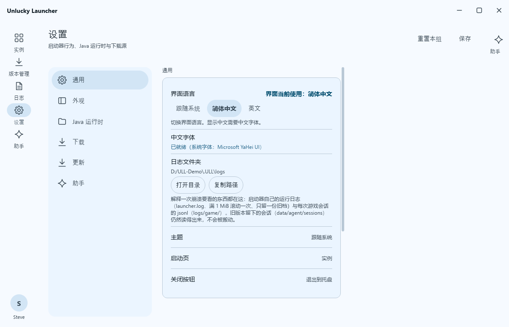

# Unlucky Launcher (ULL)

[English](README.md) · **简体中文**

> **官方项目主页**：<https://github.com/AskaEth/Unlucky-Launcher> ｜ 下载、议题、发布说明都在这里：
> <https://github.com/AskaEth/Unlucky-Launcher/releases>
>
> **本文档对应版本：`0.2.3`**——`unlucky-launcher --version` 打出来的是同一个号。

Unlucky Launcher 是一个用 Rust 写的免费开源 **Minecraft: Java 版**启动器（Apache-2.0）。每个平台就是
**一个原生二进制**——没有安装包、没有捆绑运行时、没有 WebView——从装一个版本到读懂一次崩溃，它把启动器
该做的事都覆盖了：实例与版本、加载器与整合包、Mod / 资源包 / 光影、逐实例 Java、微软 / 第三方社区服 /
本地离线账户，以及一套在本地按 YAML 规则跑的崩溃诊断。你的数据不经过我们自己的任何服务：账户令牌只
留在本机。


*实例页——1180×760，英文界面，浅色档。实例名是测试数据，不是谁的真实存档。图里那句
`Launch failed · exit0 静默失败` 也正好是一处已知缺口的诚实样子：那行原因仍是启动层直接抛出来的中文
原文（见[还没做](#还没做)）。*

## 现在能用什么

### 实例、版本与启动

- **实例**——list-detail 版式：左侧是本地实例列表；右侧是所选实例的版本、加载器、隔离方式（独立游戏
  目录或共享目录）、文件是否在盘上、上次游玩时间，以及 Play / Stop。窄窗是把两个面板整页切换，不是上下堆。
- **实例从哪来**——装一个版本（带实例名、加载器与加载器版本），或者导入一个整合包。实例页自己的
  **新建实例 / 导入 / 复制 / 打开文件夹 / 删除** 五个按钮**还没接后端**：它们是占位动作，点了只往
  stderr 写一行（`crates/app-iced/src/app/update/page_messages.rs`），欠的是实例向导
  （`crates/app-iced/src/pages/mod.rs` 偏离 #8）。
- **版本管理**——三栏（版本类型 / 主版本 / 搜索）读 Mojang 版本清单：正式版、快照、远古版；安装时可选
  加载器与加载器版本。取消安装是真停：在下一个段边界收手，在飞的那个文件就地掐断，且不登记实例
  （`crates/presenter/src/host/dispatch.rs:61-88`）。命令行还能只出计划不下载（`--dry-run`：按类的文件数
  与总大小，人类可读输出里每类给一个源链样本；整份文件清单在 `--json` 里）。
- **启动**——10 阶段命令行组装（`crates/core/src/launch/`）、逐实例 JVM 与游戏参数、原生库解压落位，
  每次运行留一份 JSONL 会话记录。进程按**进程树**杀，不是只杀一个 PID。
- **实例级启动参数**——JVM 参数、游戏参数、内存、Java 可执行文件与图形后端（`default` / `opengl` /
  `vulkan`）落在实例文件的 `launch.*` 里，**每项各自回落**：实例 → 全局设置 → 出厂默认，所以只填了内存的
  实例不会把全局 JVM 参数一起顶掉。JVM 参数是**追加**（全局先、实例后，JVM 同名选项后出现者赢）；越界的
  内存值当作「没填」，而不是拿 `-Xmx0m` 把 JVM 启动弄崩；留空即「跟随」。游戏版本够低时后端那一行直接不
  出现。CLI 与 GUI 读的是同一份生效值（`crates/core/src/game/launch_overrides.rs`）。
- **崩溃诊断是真的、也是本地的**——`crates/core/src/diagnose` 采五类信号（退出码、`latest.log`、
  `crash-reports`、`hs_err_pid`、含 mod 清单的环境快照），按 YAML 规则集匹配，把结论与修复动作显示在
  日志页上。不接模型、不联网：断网能用，没有 GPU 的机器也能用。

### 加载器、整合包与内容库

- **加载器**——Fabric、Quilt、NeoForge、Forge。需要跑官方 installer `processors` 的 Forge/NeoForge 版本
  会真跑一遍；机器上没有 Java 时先装一个托管 JDK。
- **整合包**——导入 CurseForge 清单、Modrinth `.mrpack`、MultiMC/Prism 实例；导出为 `.mrpack` 或
  CurseForge 清单。**导入**的取消只是界面级：面板立刻收回、结果作废，但后台那次导入会跑到底——core 的
  导入请求还没有取消令牌（`crates/presenter/src/host/addon/pack.rs:28-42`）。
- **导入冲突逐文件决策**——写盘之前先扫一遍：每个冲突文件（是什么、为什么冲突、多大）分页列出（每页 40
  条），三个入口定这一批——全部保留、全部覆盖、逐项选择（没点过的行留在「保留」）。不冲突的文件一律不重
  写，导入报告事后仍逐条列出全部冲突。
- **内容库**——整合包 / Mod / 资源包 / 光影，带关键词、来源、版本、加载器与排序筛选，分页结果，
  以及一键**装入这个实例**。
- **在线源：Modrinth（匿名）**——检索走 `/v2/search`，facets 从目标实例推出来（项目类型、游戏版本、
  加载器）；详情与版本列表随后取，已知摘要的远端条目再用 `/v2/version_file/<hash>` 补全。不需要 API key，
  也不发 POST（下载引擎没有请求体字段，所以摘要一条一条 GET 查）。离线是**独立的一态**——「未联网」，
  绝不说成「没有匹配的内容」。
- **这一页会拒绝什么，就写在那一行上**——整合包**不能**从内容库直接装（整合包走上面的导入管线）；
  CurseForge 的「装入」是禁用态，因为它的文件端点还没接通；游戏版本或加载器对不上目标实例的条目也是
  禁用态，并把不匹配写清楚。没有一条是静默失败的。
- **CurseForge 检索要 key**——启动前设 `ULL_CF_API_KEY`，没有它这个来源在来源筛选里是灰的。key 只活在
  环境变量里：不写进配置文件、不进日志（`crates/presenter/src/host/addon.rs`）。

### Java

逐实例的托管 JDK，四家发行版的回退链**按地区排**——Temurin 打头，国内是 Oracle 先于 Microsoft
（那边实测快 28×）、国外反过来，Zulu 收尾——可用 `java.vendorPriority` 设置整体覆盖
（`crates/core/src/game/java/vendor.rs`）。镜像也按地区选。`java list` 把它真能找到的每个 JDK 都列出来
（包括官方启动器自己下的那些），`java install <主版本>` 拉一个。游戏要的 JDK 是启动器的数据，不是启动器
本身的依赖。

### 账户

三条轨道在同一页：

- **微软**——OAuth 2.0 设备码流程 → Xbox Live → XSTS → `api.minecraftservices.com`。
- **第三方社区认证服**（authlib-injector 一类）。
- **本地离线档案**，用于隔离测试。

**微软登录在官方构建里开箱即用。** 发布版二进制已内置它需要的 Azure 公共客户端 id（公共客户端 id 不是
凭据，本来就随二进制一起分发），所以登录前不需要任何配置。设 `ULL_MSA_CLIENT_ID=<id>` 仍可覆盖内置值：
变量在启动时读取，改完要**重启启动器**。从源码构建时该变量有什么就烘什么（`ULL_MSA_CLIENT_ID=<id> cargo build`，
经 `option_env!` 烧进二进制）。两处都没有 id 的构建点登录**不会联网**，弹窗直接说清是这一项没配：标题
「微软登录未配置」，正文点名 `ULL_MSA_CLIENT_ID=<id>`（设好或构建时注入后重启），并带
`代码：msa_not_configured`；它**不给重试按钮**，因为在同一个进程里重试必然是同一个错。其它登录失败仍是
老样子：一句分类文案 + `代码：<码>`，完整原因只在启动器日志里。第三方社区服与本地档案不需要 id。

### 外观与语言

- **只有一套 UI 栈**——iced 0.14 + Material 3 Expressive，自绘标题栏、带动效的导航轨，浅色 / 深色 /
  跟随系统。
- **外观**——窗口背景图与取色链路（面板配色可从壁纸推出来）、面板透明度、整窗透明度（Windows）。Windows 11
  与 Server 2025 上向系统请求外框圆角；macOS 与 Linux 交给桌面合成器自己的规则；我们不自己画圆角。
- **CPU 兜底**——`--software-renderer` 让没有可用 GPU 或驱动有问题的机器照样正常显示；没有可用适配器时，
  后端探测自己退到 CPU。这条路上**面板级**半透明与模糊会关掉（**窗口级**透明度照常可用），设置面板会写明。
- **本地化**——跟随系统语言探测、设置里可显式切换、重启后保持。绝大多数文案来自同一份消息目录
  （`crates/i18n`）。**边界，因为上面这句很容易被读大**：防硬编码的守门
  （`crates/app-iced/src/pages/instances/tests/i18n.rs`）只扫实例页源码，不是每一屏；写死的中文字面量里
  没有 ASCII 单词可以匹配，这一类它抓不到；外观面板的老控件还是硬编码英文
  （`crates/app-iced/src/pages/appearance/section.rs`），中文界面下它们仍显示英文。

### 助手，以及 MCP server

这是两件不同的事，README 不该含糊：

- **启动器内的助手今天还是占位壳。** 它的 transport 是脚本化的
  （`crates/app-iced/src/presenter/transport.rs`），没有接真实模型，而且界面上它出现的每一屏都用四处明说
  这一点——副标题、输入框占位符、空态正文，以及一枚「模拟」胶囊。会话状态、未读数、草稿、确认流程与具名
  失败码都是真的 presenter 状态；缺的只是它们后面的模型。
- **MCP server 是真的。** `ull agent serve` 把启动器内核以 MCP server 形态（stdio 或 Streamable HTTP）
  开放给外部 Agent 工具，只监听回环（`127.0.0.1`，默认端口 47823），除非
  `agent.mcp.allow_write=true` 否则只读。十个工具规格（`crates/agent/src/tools/`）同时喂给两种形态，两条
  路都过同一个执行器——schema 校验、敏感分级、审计留痕。`ull agent config` 能打印现成的 Claude Code /
  Cursor 配置片段。

### 命令行

GUI 二进制在跑任何 UI 代码之前就先认全部 CLI 子命令——不开窗、不探渲染器、不扫字体。另有一份更轻的 `ull`
产物，命令集相同，却一个图形栈都不链接。

```bash
unlucky-launcher                            # GUI
unlucky-launcher --software-renderer        # GUI，CPU 渲染
unlucky-launcher instances list             # CLI，不开窗
unlucky-launcher --json launch 1.20.1       # CLI，全局选项排在子命令前面
unlucky-launcher --version                  # CLI，版本 + 系统摘要
```

判据刻意收得很窄，所以原本能用的用法一条都没变：

- 第一个参数是裸词（不以 `-` 开头）→ 它就在子命令的位置上，交给 CLI。GUI 的 flag 永远不会出现在那个位置：
  `--screenshot` / `--diff` / `--data-dir` 的取值都排在 flag 之后。
- 第一个参数是 flag → 只有当 `crates/cli` 的解析器也解析出一条真命令时才算 CLI 调用（`--help`、
  `--version`、`--json instances list`）。单独 `--data-dir X` 解析成「没有子命令」，仍然开 GUI；GUI 专属
  参数（`--software-renderer`、`--screenshot*`、`--renderer`、`--theme`、`--diff`、`--force-state` 等）
  在 CLI 里一律解析失败，也仍然开 GUI。

**未知子命令是错误，不是开窗**：`unlucky-launcher lst` 打印「未知命令 `lst`」、提示
`unlucky-launcher --help`，以 1 退出。静默开窗会让脚本以为自己那个拼错的参数生效了。子命令表只有一处定义
（`crates/cli/src/cli/parse.rs`），所以两个二进制认的命令集天然一致。`ull --help` 会全列出来：`instances`、
`install`、`launch`、`pack import`、`accounts`、`sessions`、`logs`、`diag`、`config`、`java`、`update`、
`agent`、`version`、`help`。

### 自更新与稳定通道

- **自更新是真的，而且 GUI 与 CLI 共用同一个内核。** 设置页的「更新」组与 `ull update check` /
  `ull update apply` 造的是同一个 `core::update::Job`（`crates/core/src/update/`）：取
  `releases/latest/download/manifest.json`、比版本、过渠道准入、校验长度 + SHA256，再原子换包——把旧文件
  改名挪开、把新的搬进去，失败就回滚。Windows 上正在运行的 exe 能**改名**、不能覆盖，所以换包是改名。
- **四种结论不许混**：已是最新 / 有可装的更新 / 有更高版本但里面没有本平台产物 / 检查本身失败（断网、清单坏、
  渠道不符）。失败绝不会被说成「已是最新」。
- **只发布 stable 通道。** `update.channel` 默认 `stable`；beta / alpha / nightly 已建模但不发。清单准入要两条
  同时成立——清单自称的渠道与版本号里的预发布阶段：清单会撒谎，版本号不会。
- **为什么发布必须被标成稳定版**：`releases/latest/download/*` 只指向**非 prerelease** 的最新 Release，而清单
  地址就钉在它上面。`0.2.3` 是第一个不带预发布标记建出来的版本（`0.2.2` 保留为历史预发布）。「哪种触发创建什么
  标记」只有一张表（`packaging/release_marker.py`），并由 `packaging/check_release_semantics.py` 守着。
- **没有任何东西背着你自动安装。** 启动时的检查可以关掉（`update.auto_check`，CLI 读的是同一个键），安装要么是
  点按钮，要么是显式 `ull update apply`。调试构建可以拿本地目录源把整条链演练一遍（`ULL_UPDATE_DIR`）；发布
  构建里**不存在**这条路径。

### 日志在哪

启动器自己这一侧写的东西全在 `<数据根>/logs/` 一个目录里。设置页有一行**日志文件夹**，直接显示这个
路径，旁边是 *打开文件夹* 与 *复制路径*；日志页页头也有 *打开文件夹*。



*设置页 → 通用 → 日志文件夹。路径就是当前实际生效的日志根（便携 / 标准 / 自定义三种数据模式各自不同），
打开失败时这一行照样显示，右按钮把路径送进剪贴板。*

数据根按三种模式取值：便携是 `<exe 目录>/.ULL`，标准是 `<用户应用数据目录>/ULL`，自定义是
`<自定义根>/.ULL`——与设置页显示的「启动器数据目录」是同一个值。

| 路径 | 是什么 |
|---|---|
| `logs/launcher.log` | 启动器自己的运行日志：后端探测、字体/主题决策、后端选择、**渲染后端起不来时的具名原因**，以及每一次启动（命令行事实、spawn 结果、退出码）。满 1 MiB 滚成 `logs/launcher.1.log`，**只留一份**旧档，所以它不会无限长大。 |
| `logs/launcher.1.log` | 上一份 1 MiB，下次滚动时被替换。 |
| `logs/game/<session-id>.jsonl` | 每次启动一份 JSONL 事件流：命令行（已脱敏）、每一行 stdout/stderr、退出码。 |
| `logs/game/index.jsonl` | 一会话一行摘要的索引，日志页左栏读的就是它。 |
| `logs/install.log` | 安装流水：每个阶段一行。 |
| `logs/session-log-location.json` | 会话日志现在在哪、以前在哪的记录，每次启动重写。 |
| `data/agent/sessions/game/…` | **只读兼容**：旧版本写下的会话。仍然列得出来、打得开；不搬动、不删除任何一个文件。 |

游戏自己的文件不在这里，而在实例的运行目录里：`logs/latest.log`、`crash-reports/crash-*.txt`、
`hs_err_pid*.log`。**`crash-reports/` 只在 JVM 活到那一步时才存在。** 模组、缺库或 Java 选错把游戏
弄死在 Minecraft 初始化之前时，游戏根本没机会写它——那种时候诚实的证据是会话 JSONL 与
`launcher.log`，不是崩溃报告。这是游戏的行为，不是启动器藏了什么。

### 还没做

这份清单是让人相信上面那些话的理由。没有一条藏在宣传话术后面。

- **没有安装包。** 下个文件直接跑——没有安装步骤；更新是就地替换那个文件，不装任何东西
  （见[自更新与稳定通道](#自更新与稳定通道)）。
- **更新链路只用本地目录源演练过。** 整条链（清单 → 下载 → SHA256 → 改名/回滚）是拿调试构建 + 夹具跑的，
  因为 `0.2.2` 还是预发布期间读不到真实的 `releases/latest/download/manifest.json`。线上稳定通道的第一次
  观察要等 `0.2.3` 发出去之后。
- **有一批按钮是占位。** 实例页：*新建实例*、*导入*、*复制*、*打开文件夹*、*删除*。
  设置页框架：*保存*、*重置本组*、*添加覆盖*。点下去只往 stderr 写一行 `[page] 占位动作 …`，什么都不改
  ——图形界面里的实例管理就是还欠着的那块实例向导；设置项是边改边生效，而不是靠「保存」。
  （日志页与设置页的「打开日志文件夹」**不再**是占位：它真的会打开 `<数据根>/logs`，见[日志在哪](#日志在哪)。）
- **Linux x64 已发布，但「已发布」= 真能跑，不等于观感已定型。** 发布流水线默认就在原生 Ubuntu 22.04 上编
  `linux-x64` 并发出去，依据是：release 产物本身在真显示服务（WSLg）下起过窗、渲出一帧非空白画面、主题与渲染
  后端的日志行齐全（实测输出见 `packaging/docs/linux-evidence.md`），而且同一条判据已经常驻成发布流水线里
  **这个槽位**的门禁。还没人看过的：真实桌面发行版上的拖动/缩放，以及真桌面会话里的字体度量与中文整形。
  「整窗透明度」与「圆角」这两条在 Linux 上**根本没有代码路径**（不是未验）：前者要窗口句柄，Linux 上拿不到
  （`hwnd=none`）；后者交给桌面合成器（`corner=policy=system`），我们不自己画。
  `linux-arm64` 只是**编出来了，没发布**——没有任何 ARM64 机器跑过它一帧，产物只作构建证据留着。
- **macOS 不由发布流水线构建，也未定型。** 有两轮真机证据（Apple Silicon），构建因此存在——但菜单栏显示名、
  三个窗口按钮的位置（macOS 习惯在左上，我们自绘在右上）、300s+ 稳态仍需真机复核。macOS 产物未签名，
  首次启动要自己清掉 Gatekeeper 隔离标记（`xattr -d com.apple.quarantine`）。macOS 运行期冒烟是手动
  `workflow_dispatch` 的探针、带 `continue-on-error`，不是门禁；`gh workflow run release.yml -f all_slots=true`
  能编这两档取证，但它们从不发布。
- **内容库页在低窗口高度下会挤**，而且窗口高度还没接进页面模型——这一页按一个名义高度排版，而不是按它
  真正拿到的高度。
- **启动侧失败提示未结构化。** 磁贴直接采用启动层抛出的中文句子
  （`crates/core/src/launch/exit_analysis.rs`），而不是一个界面能翻译的原因码——上面那张英文截图里的
  `静默失败` 就是它。
- **启动器内的助手背后没有模型**（见上）。MCP server 有。
- **内容库的安装进度是阶段级**，不是字节级。
- **没有原生文件选择框。** 导入靠拖拽或粘贴路径。
- **Android/Termux 是试验级、不承诺**：发布矩阵里没有面向它的资产。GUI 可以经 glibc 工具链源码自建（见 `packaging/docs/termux-glibc-build.md`，分支说明见 [`README.termux.md`](README.termux.md)），已真机验证两条路径各一次：CPU 软渲染，以及自编 Mesa/turnip 栈的 GPU 加速（证据见 `README.termux.md`）。

## 下载与运行

从 [Releases](https://github.com/AskaEth/Unlucky-Launcher/releases) 拿你那个平台的文件。文件名形如
`unlucky-launcher_<版本>_<平台>_<架构>`；这个形状的唯一真相源是
`packaging/make_artifacts.py::asset_stem()`：

| 槽位 | 产物 | 形态 |
|------|------|------|
| `windows-x64` | `unlucky-launcher_<版本>_windows_x64.exe` | 裸 `.exe`，双击即用 |
| `linux-x64` | `unlucky-launcher_<版本>_linux_x64.tar.gz` | 单个归档，解压出一个顶层目录；要 glibc 2.35+ 与 X11/Wayland + fontconfig 那一套 |
| `windows-arm64` | `unlucky-launcher_<版本>_windows_arm64.exe` | 裸 `.exe` —— **编了、不发布**，见下 |
| `linux-arm64` | `unlucky-launcher_<版本>_linux_arm64.tar.gz` | 同上 —— **编了、不发布**（运行时零证据） |
| `macos-arm64` | `unlucky-launcher_<版本>_macos_arm64.tar.gz` | 同上 —— 发布流水线**不构建** |
| `macos-x64` | `unlucky-launcher_<版本>_macos_x64.tar.gz` | 同上 —— 发布流水线**不构建** |
| 每个已发布槽位 | `ull_<版本>_<平台>_<架构>[.exe]` | 裸 CLI 文件，独立资产 |
| 全平台 | `SHA256SUMS.txt` | `sha256sum -c` 可直吃 |

**本版发布 `windows-x64` 与 `linux-x64`，就这两档。** 发布 job 只留 `PUBLISH_SLOTS` 里点名的槽位
（`.github/workflows/release-publish.yml`），其余产物在写 `SHA256SUMS.txt` 之前就被删掉——所以表里标
**不发布** 的行是命名规则，不是本版可下载的资产。三条关系都有守卫（`packaging/check_publish_slots.py`）：
名单里点名了却没产物 ⇒ Release 变红（`linux-x64` 构建红了就挡住整次发布，靠的就是这条）；产物在、名单没点名
⇒ 显式打「未发布」警告，不再静默删掉；`mode: ci` 的槽位本次连产物都没有（那一档红了）⇒ 也打警告。

不发布的行里 CI 真编两档。`windows-arm64` 在 GitHub 原生 `windows-11-arm`（Windows 11 Arm64 + Visual Studio
2026）上编来取证——**诚实一句**：此前每一次 arm64 红都红在**编译前的工具链体检**，`cargo build` 一次都没跑过；
M164 把那个体检降级成只取证，所以**下一条 tag 的 CI 才是第一次真正问编译器**。`linux-arm64` 在原生
`ubuntu-22.04-arm`（与 x64 同 glibc 地板）上编，不发布的理由完全不同：**没有任何 ARM64 机器跑过它**。
解锁条件 = 真机渲出一帧 + 主题/后端日志行，之后才把键加进 `PUBLISH_SLOTS`。

Linux x64 的安装就是解开归档直接跑：

```bash
tar -xzf unlucky-launcher_<版本>_linux_x64.tar.gz
cd unlucky-launcher_<版本>_linux_x64
./unlucky-launcher                      # 没有可用 GPU 适配器就加 --software-renderer
```

载入期要 glibc 2.35+、`libxkbcommon`、`fontconfig`、`libGL`；Debian/Ubuntu 上
`sudo apt-get install libxkbcommon0 libfontconfig1 libgl1 libx11-6 libxcursor1 libxrandr2 libxi6` 就够。
与归档并列的裸 `ull_<版本>_linux_x64` 连显示都不需要。

UNIX 归档里是二进制加 `LICENSE`、`NOTICE`、`README.md`，都在一个顶层目录下。Windows 发的是裸 `.exe`
（一个文件装不下这三份文本），所以这三份作为并列资产挂在 Release 上——下 Windows 二进制不会把许可条款
弄丢。下载链接里不带实现细节字样，归档里的二进制名永远是 `unlucky-launcher`。

这两种形态不是重复品。GUI 二进制开窗时要用图形栈（X11 / Wayland / GL 走 `dlopen`，启动时直接链接
`libfontconfig`）；`ull` 除了 glibc 什么都不需要，所以在没有窗口的服务器、CI 容器上跑得起来。Linux 上这个
地板是 glibc ≥ 2.35（槽位在 Ubuntu 22.04 上构建）——更老的发行版得源码自建（`packaging/README.md` §4）。
没有桌面就用 `ull`，有桌面就用 `unlucky-launcher <子命令>`。两者打出来的 CLI 文案是同一套，自称的名字跟着
**你敲的那个文件**走——`argv[0]` 去掉目录与结尾的 `.exe`，别的都不剥
（`crates/cli/src/cli/program.rs`），所以 `ull` 打印 `ull ·`，归档里那个二进制打印
`unlucky-launcher ·`，本地 `cargo build` 出来的打印 `unlucky-launcher-iced ·`。

最低平台基线：**Windows 10**；Windows 8.1 / 8 / 7 不在支持范围内。macOS 12+（Apple Silicon 与 Intel），
Linux x64 / arm64（基线判定在 `crates/core/src/platform/os_info.rs`）。Windows 10/11 的产物由标准工具链
（MSVC / GNU）构建，构建方式与上游 cargo 一致。Linux 上 X11 是当前首选路径，Wayland 是大方向。能力差异
一律用 feature gate + 运行期探测表达，绝不做成「这个平台天生少一块」的编译期裁剪。

第一次用微软账户？不用配置——官方构建已内置客户端 id，见[账户](#账户)。其它都不需要配置。

## 从源码构建

前置：

- Rust stable（`rust-toolchain.toml` 会自动选工具链；门禁还需要 `rustfmt` / `clippy` 组件）
- Windows：MSVC 工具链（CI 用这套）或 MinGW-w64（`x86_64-pc-windows-gnu`）
- Linux：`libxkbcommon-dev libfontconfig1-dev libgl1-mesa-dev libegl1-mesa-dev libwayland-dev
  libxcb1-dev`——winit + wgpu/tiny-skia 编译期要用

```bash
cargo fmt --all --check                                # 格式
cargo clippy --workspace --all-targets -- -D warnings # 静态检查（零 warning 门禁）
cargo test --workspace                                 # 测试
cargo build --release                                  # bin 落在 target/release/
cargo deny check licenses bans sources                 # 依赖许可（CI 必跑）
```

编出来的 bin：

- 从源码构建默认不带微软客户端 id：想让产物自带，就在构建时设 `ULL_MSA_CLIENT_ID`（`ULL_MSA_CLIENT_ID=<id>
  cargo build`）；官方发布产物已内置，见[账户](#账户)。
- `unlucky-launcher-iced`——GUI，同时也是 CLI：同一个文件认上面列的全部子命令。名字里的 `iced` 是 cargo
  的 bin 名，不是下载名——`packaging/make_artifacts.py` 把同一次构建落成
  `unlucky-launcher_<版本>_<平台>_<架构>`，归档里的二进制名写成 `unlucky-launcher`。
- `ull`——CLI 的独立无 UI 构建：同一套命令、不链接图形栈、体积更小，给完全没有显示设备的机器用。

渲染开关：

- `unlucky-launcher-iced --software-renderer` 强制 tiny-skia（`ICED_BACKEND=tiny-skia`）；
  `--screenshot <png>` 出一帧图后退出——这是 CI 无头冒烟 job 用的验收通道
- 没有可用适配器时，iced 版靠显式后端探测自己退到 CPU

**CI 门禁。** 每次推送到 `main` 与每个 PR 都跑 fmt / clippy（warnings 视为错误）/ 全量测试，Linux 无头
渲染冒烟与它们同级、是硬门禁：在 Xvfb 里真渲染一帧，再断言 PNG 非空白，红了就不许合。macOS 探针还不算
——只手动 dispatch，结果留证据但不作为流水线结论。

| Workflow | 内容 |
|----------|------|
| `.github/workflows/ci.yml` | fmt + clippy + test + release build（Windows / Linux 矩阵）；Linux runtime smoke（Xvfb 真渲染一帧、断言 PNG 非空白）；macOS 运行期探针（仅手动 dispatch） |
| `.github/workflows/guards.yml` | `crates/core` / `crates/presenter` / `crates/design` 零 UI 守门、单文件 ≤400 行守门、cargo-deny 许可与来源守门 |
| `.github/workflows/release.yml` | tag `v*` → 构建默认四档（`windows-x64` + `windows-arm64` + `linux-x64` + `linux-arm64`，各自原生 runner）→ 单文件产物 + `SHA256SUMS.txt` → GitHub Release（发布 `windows-x64` 与 `linux-x64`；`linux-x64` 另有一条同槽位的 Xvfb 首帧门禁；`-f all_slots=true` 才整表六槽位取证） |
| `.github/workflows/release-guard.yml` | 发布标记语义守门：push tag ⇒ **稳定版**、dispatch `prerelease=true` ⇒ 预发布；标记表在 `packaging/release_marker.py`，守门会对自己做变异自测 |

## 架构与模块地图

```
Unlucky-Launcher (cargo workspace)
├── crates/core       # 领域库：零 UI 依赖，八模块
├── crates/agent      # AI Agent：ToolSpec 注册表 + 内置客户端 + MCP server（双形态共用一个内核）
├── crates/presenter  # 业务宿主层：与框架无关的 state / host / dto / 转换
├── crates/design     # 设计令牌：真 HCT 色彩 / 排版 / 形状 / 间距 / 高程 / 动效 / 图标 / 组件度量
│                     #   —— 零 UI 依赖、零第三方 crate
├── crates/i18n       # 语言探测、消息目录、中文字体策略
├── crates/palette-extract  # 唯一解码图片的 crate，供壁纸取色链路使用
├── crates/app-iced   # iced UI（bin `unlucky-launcher-iced`）：workspace 里唯一的 GUI bin
├── crates/cli        # CLI（bin `ull`）：headless，零 UI
└── packaging         # 单文件产物矩阵与发布脚本
```

层间纪律：`app-iced` → `presenter` → `core` / `agent`。`design` 与 `i18n` 只被壳层与 presenter 消费；
它们都不得反过来依赖渲染框架，CI 守门会拦。

`crates/core` 的八个模块：

| 模块 | 职责 |
|------|------|
| `setting` | 三模式数据目录、schema 配置、原子写、迁移 |
| `download` | 多源健康度、镜像、分块下载、边下边算 |
| `game` | 版本/实例仓库、快照与继承解析 |
| `launch` | 10 阶段启动管线、进程、JSONL 事件流 |
| `auth` | Microsoft 账户登录（OAuth 2.0 device code → Xbox Live → XSTS → Minecraft Services）、第三方社区服、本地档案 |
| `addon` | 加载器安装、整合包、CurseForge / Modrinth、整合包导出 |
| `diagnose` | 五类信号采集、YAML 规则引擎、hs_err 解析 |
| `platform` | OS 抽象：路径、进程、文件锁、能力探测、运行期 OS 检测 |

## 许可证与致谢

- **本项目**：Apache License 2.0，见 [LICENSE](LICENSE)；第三方声明见 [NOTICE](NOTICE)。
- **iced**（<https://github.com/iced-rs/iced>），MIT：现役 UI 的框架；与它同栈的 `winit`（Apache-2.0）、
  以及经它引入的 `wgpu`（MIT / Apache-2.0）/ `tiny-skia`（BSD-3-Clause）。
- **Google Material Color Utilities**（Apache-2.0）：`crates/design` 的色彩令牌是它 HCT /
  ColorSpec2021 算法的 Rust 重写移植，移植清单与逐函数对照写在 [NOTICE](NOTICE)。
- **其余主要依赖**：MCP server 的 `rmcp` 与 `axum`（Apache-2.0 / MIT）、`tokio`（MIT）、`reqwest`
  与 rustls（MIT / Apache-2.0）、`serde` / `serde_json`（MIT / Apache-2.0）、`zip` / `flate2` / `tar`
  （MIT / Apache-2.0）。cargo-deny 强制执行的白名单在 `deny.toml`；GPL 系依赖不得进主干。

感谢 [HMCL](https://github.com/HMCL-dev/HMCL) 和 [PCL2](https://github.com/Meloong-Git/PCL)
（均 GPL-3.0）。这两款启动器陪着绝大多数 MC 玩家走了很多年，
本项目在设计取舍与实现细节上都从中受益良多。
